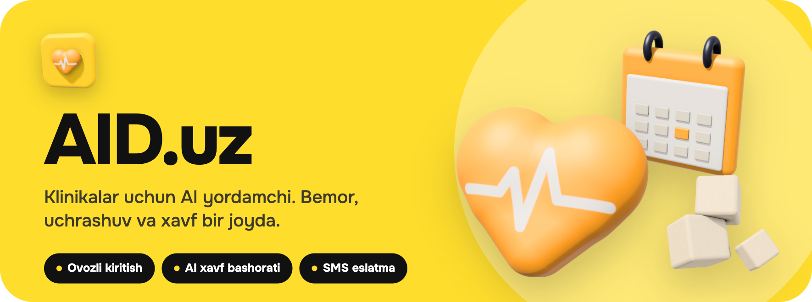
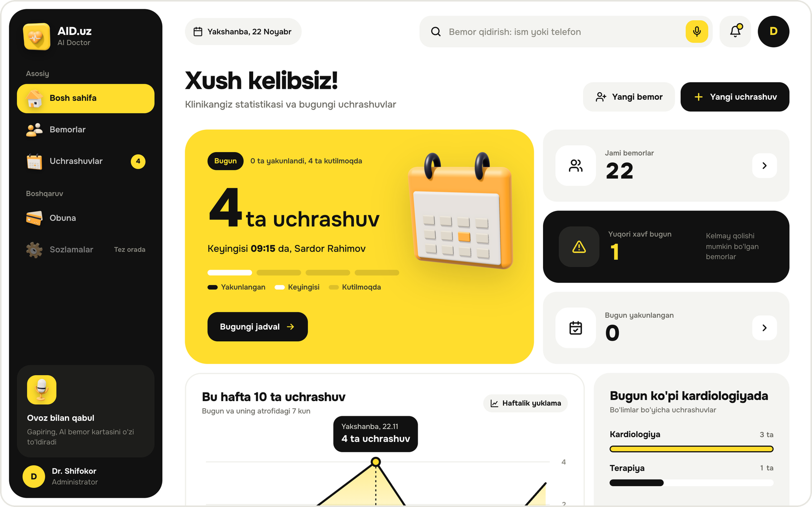
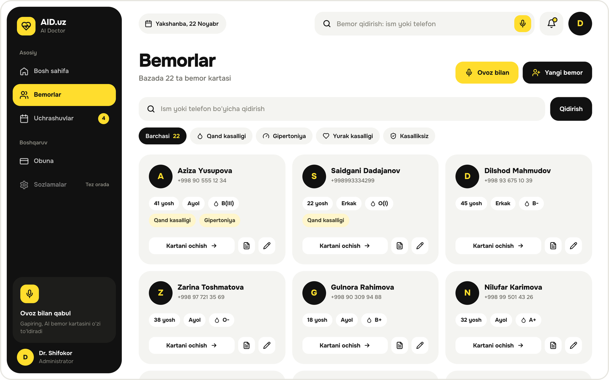
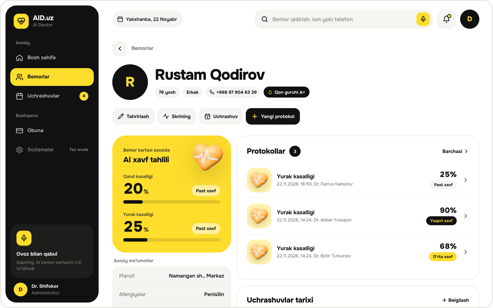
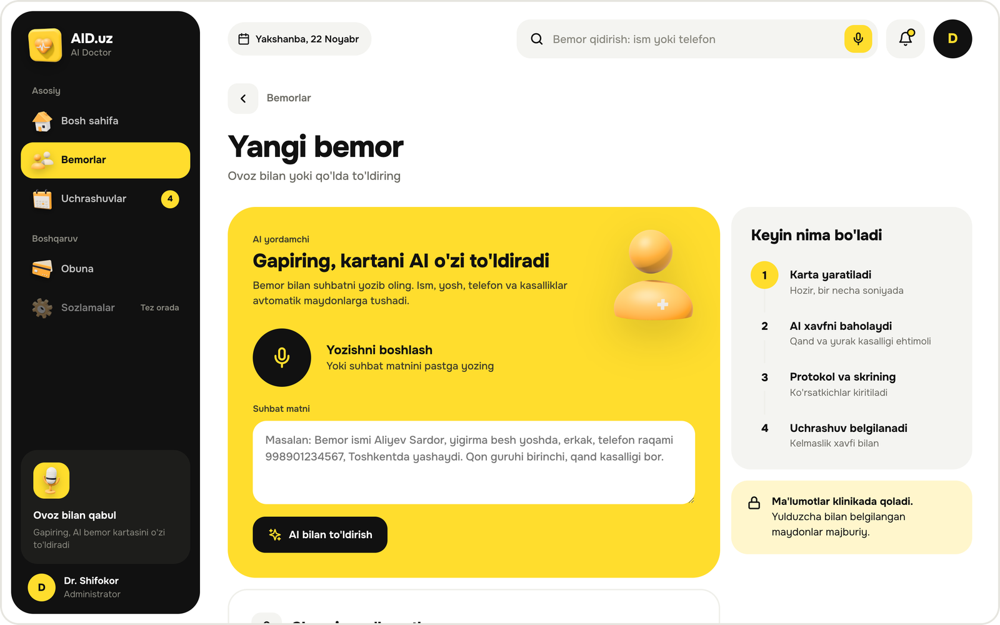
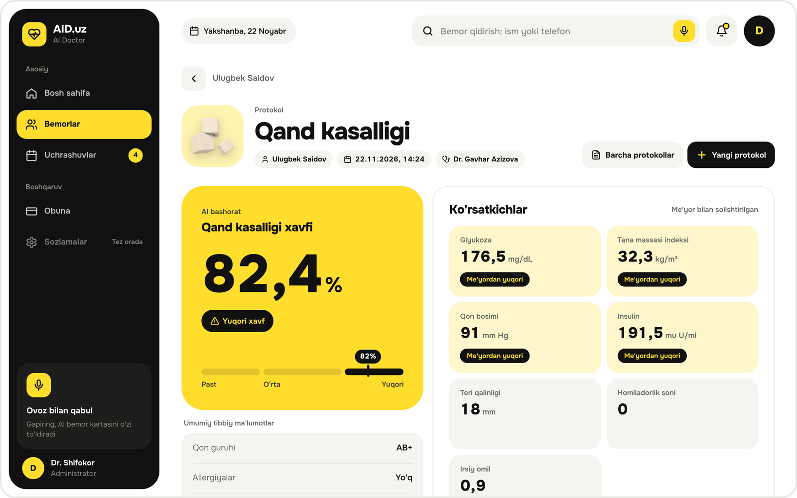
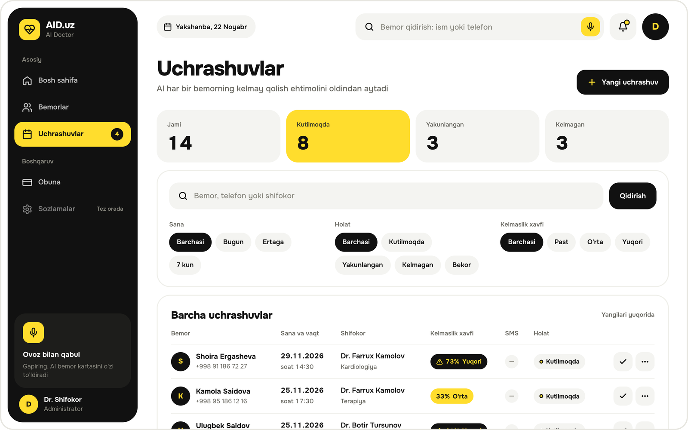
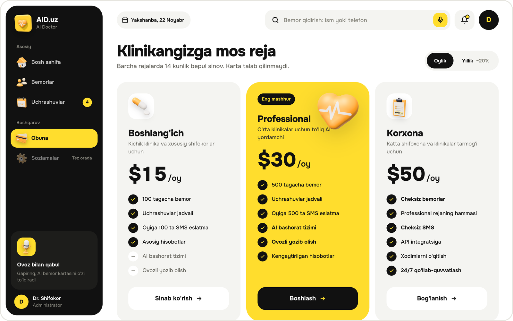
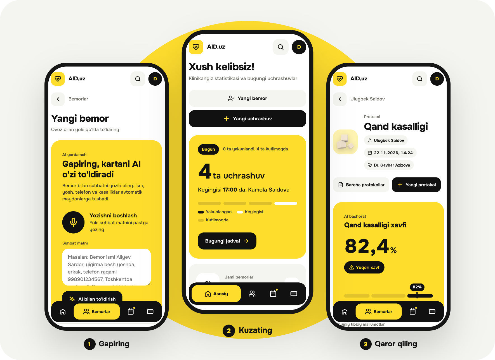

Klinikalar uchun AI yordamchi CRM. Shifokor gapiradi, AI bemor kartasini to'ldiradi va qand, yurak kasalligi hamda kelmay qolish xavfini oldindan aytadi.



| | |
|---|---|
|  |  |
|  |  |
|  |  |



## Ishga tushirish

```bash
python3 -m venv venv && source venv/bin/activate
pip install -r requirements.txt
python3 manage.py migrate
python3 manage.py runserver
```

Brauzerda: http://localhost:8000

Django, scikit-learn, OpenAI, ElevenLabs. AI Hackathon 2026.
